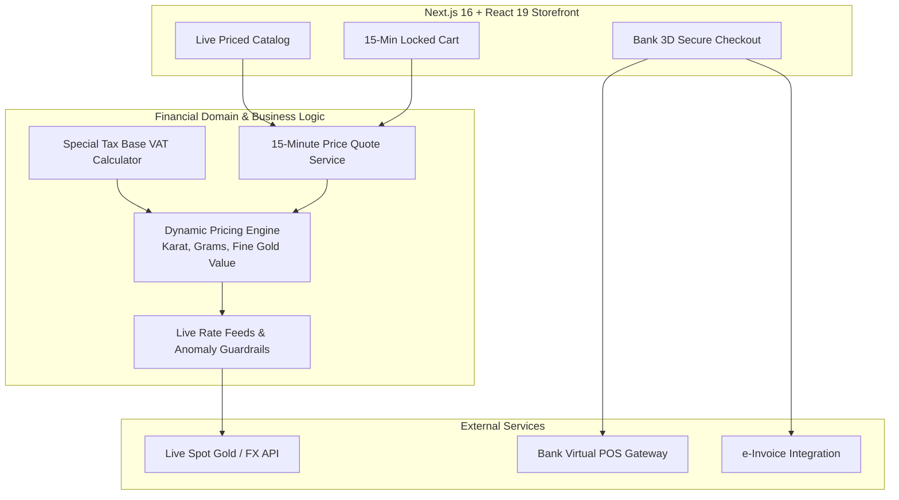

# Jewelry E-Commerce & Dynamic Gold Pricing Platform — Showcase 💍✨

**English** | [Türkçe](README.tr.md)

**A specialized e-commerce platform for the jewelry industry: live spot gold rate integration, dynamic craftsmanship margins, special tax base (VAT) calculation engine, and 15-minute price hold locks.**

> ℹ️ **About This Showcase:**  
> This repository is a **product showcase and architecture portfolio**. The full application source code (Next.js 16, React 19, Prisma models, virtual POS, and e-invoicing pipelines) is maintained in a private repository. This repository highlights the architecture, financial principles, and module plans.

---

## 🎯 Core Principles of the Jewelry Financial Engine

Standard e-commerce frameworks cannot accommodate the unique regulatory and real-time market constraints of gold and precious jewelry. This platform is engineered around these fundamentals:

1. **Single Source of Truth for Pricing:** Storefront, cart, checkout, and invoicing utilize the exact same `pricing` engine, eliminating discrepancies between payment settlement and accounting.
2. **Fail-Safe Price Publishing:** If live market feeds display excessive drift, staleness, or anomalies, price publishing automatically pauses to prevent sub-cost sales.
3. **Zero Floating-Point Inaccuracies:** Currency and weights strictly utilize `Decimal(18,4)` representations instead of standard IEEE floating-point numbers.
4. **15-Minute Price Hold Guarantee:** Due to real-time market volatility, customers receive a 15-minute price freeze upon checkout initiation.
5. **Special Tax Base (VAT) Isolation:** Compliant with jewelry tax regulations: VAT applies strictly to labor and margin, while raw gold value remains tax-exempt.
6. **Regulatory Compliance (MASAK / KYC):** Identity verification records (`KycRecord`) for high-value purchases exceeding regulatory thresholds with 8-year record retention.

---

## 🏗️ Architecture Topology

---

## 💻 Tech Stack

| Layer | Technology |
|---|---|
| **Frontend & SSR** | Next.js 16 (App Router), React 19, TypeScript, Tailwind CSS 4 |
| **Persistence & ORM** | PostgreSQL, Prisma ORM, Decimal precision storage |
| **Domain Logic** | Karat/Millesimal converter, Special VAT calculator, Price lock manager |
| **Security & Payments** | Bank-hosted 3D Secure checkout, MASAK KYC compliance |
| **Testing & Verification**| Vitest (26+ pricing & currency conversion unit tests) |
| **Specifications** | [docs/MIMARI.md](docs/MIMARI.md) · [docs/OZELLIK-PLANI.md](docs/OZELLIK-PLANI.md) |

---

## 🔒 Confidentiality Notice
Proprietary source code, banking credentials, and production configurations remain private.
