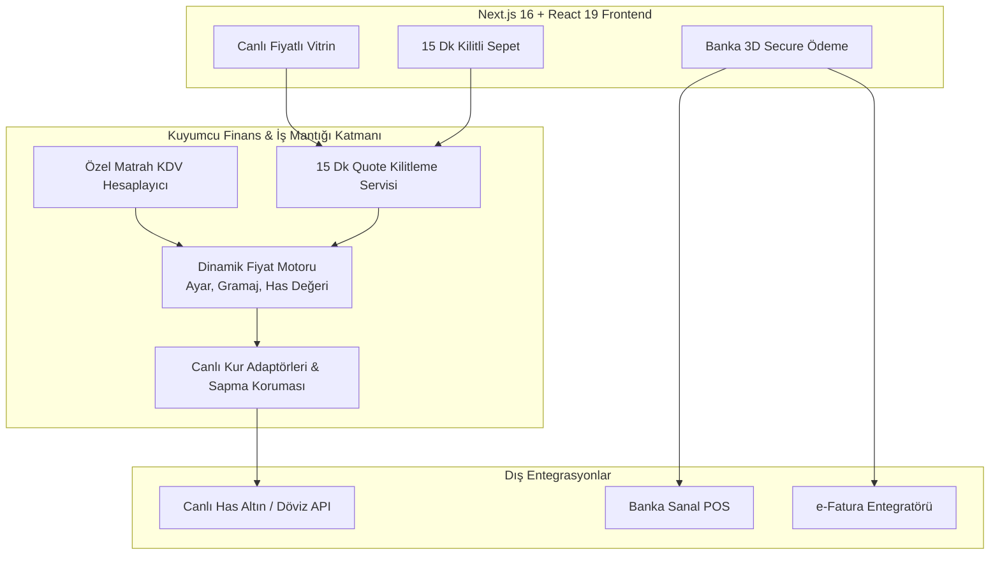

# Kuyumcu E-Ticaret ve Canlı Fiyatlama Platformu — Vitrin 💍✨

[English](README.md) | **Türkçe**

**Kuyumculuk sektörü için canlı has altın kuru bağlantılı, dinamik işçilik ve özel matrah KDV hesaplama motorlu, 15 dakikalık fiyat kilitlemeli yeni nesil e-ticaret platformu.**

> ℹ️ **Bu Vitrin Hakkında:**  
> Bu depo **ürün tanıtımı ve teknik portföy** içindir. Uygulama kaynak kodları (Next.js 16, React 19, Prisma şemaları, sanal POS ve e-Fatura entegrasyonları) ayrı bir **private** depoda tutulmaktadır. Bu depoda platformun mimari prensipleri, kuyumculuk finans matematiği ve modül planları yayımlanmaktadır.

---

## 🎯 Kuyumculuk Finans Motorunun Temel İlkeleri

Geleneksel e-ticaret altyapıları (Shopify, WooCommerce vb.) kuyumculuk sektörünün yasal ve finansal dinamiklerini karşılayamaz. Bu platform sıfırdan şu kurallarla inşa edilmiştir:

1. **Fiyat Mantığı Tek Noktadan Yönetilir:** Vitrin, sepet, sipariş ve e-fatura aynı `pricing` motorunu kullanır. Fatura ile tahsilatın tutarsız olması engellenir.
2. **Yanlış Fiyatla Satmaktansa Satışı Durdurma:** Anlık kur verisi şüpheli, bayat veya aşırı sapmalıysa sistem fiyat yayınını durdurur.
3. **Kayan Nokta (Float) Hatası Yok:** Para hesaplamalarında asla `number` kullanılmaz; tüm hesaplamalar `Decimal(18,4)` hassasiyetinde tutulur.
4. **15 Dakikalık Fiyat Kilitleme (Price Quote):** Altın fiyatları anlık değiştiği için sepet aşamasında 15 dakikalık kilit verilir; süre dolduğunda fiyatlar güncellenir.
5. **Özel Matrah KDV Ayrımı:** Kuyumculuk mevzuatına uygun olarak; KDV yalnızca işçilik ve kâr tutarı üzerinden hesaplanır, has altın bedeli vergiden muaftır.
6. **MASAK Uyumluluğu:** Belirli yasal limitlerin üzerindeki siparişlerde kimlik doğrulaması (`KycRecord`) zorunluluğu ve 8 yıl veri saklama altyapısı.

---

## 🏗️ Sistem Mimarisi

---

## 💻 Kullanılan Teknolojiler

| Katman | Teknoloji |
|---|---|
| **Web & Arayüz** | Next.js 16 (App Router), React 19, TypeScript, Tailwind CSS 4 |
| **Veritabanı & ORM** | PostgreSQL, Prisma ORM, Decimal hassas para saklama |
| **Kuyumculuk Motoru** | Özel Milyem / Ayar dönüştürücü, Özel Matrah KDV hesaplama |
| **Güvenlik & Ödeme** | Banka Hosted 3D Secure (Kart verisi sunucuda saklanmaz), MASAK KYC kaydı |
| **Test & Kalite** | Vitest (26+ matematiksel fiyat ve kur doğrulama testi) |
| **Dokümantasyon** | [docs/MIMARI.md](docs/MIMARI.md) · [docs/OZELLIK-PLANI.md](docs/OZELLIK-PLANI.md) |

---

## 🔒 Güvenlik Bildirimi
Kaynak kodlar, banka sanal POS anahtarları ve veritabanı şifreleri gizli tutulmaktadır.
