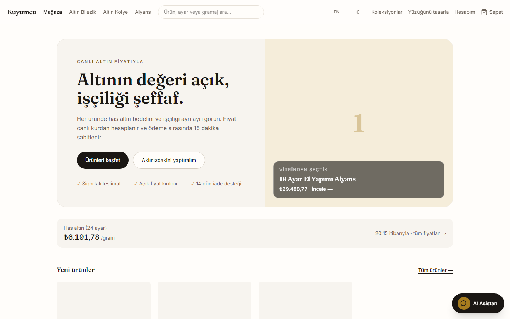
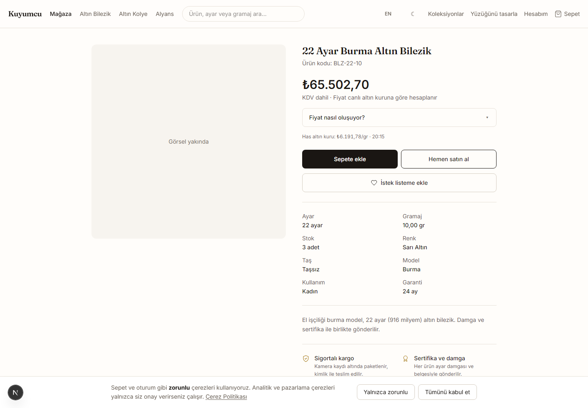
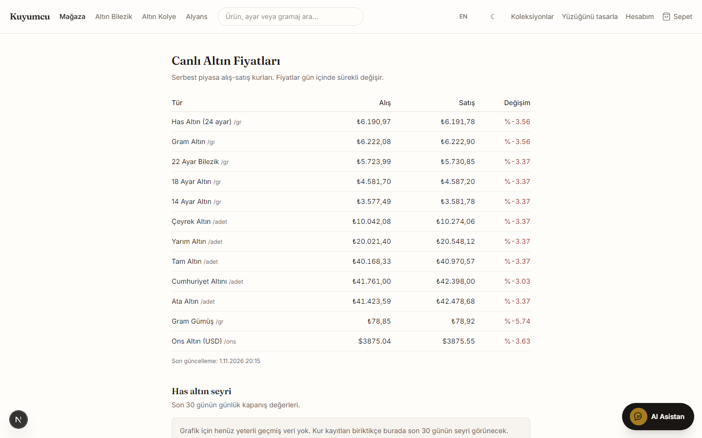
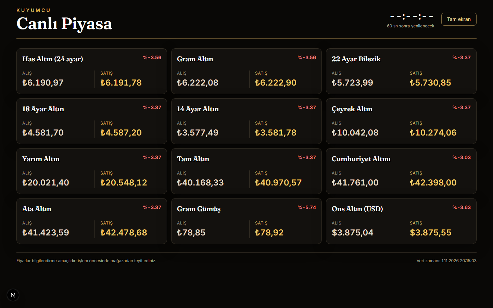
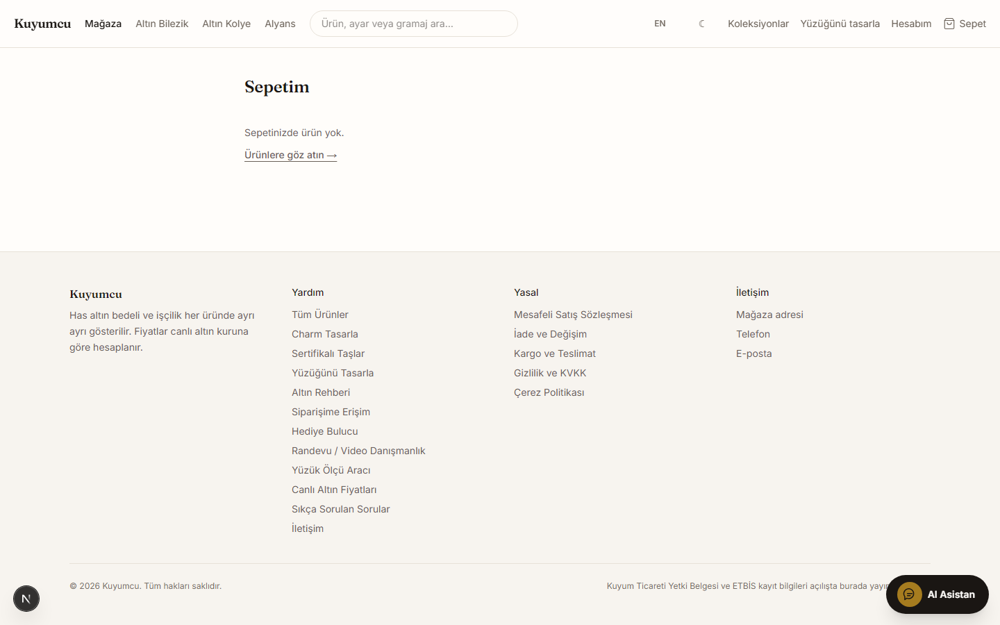
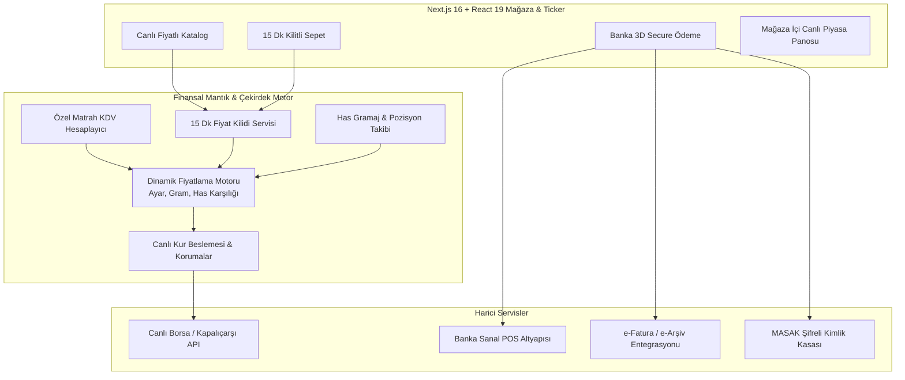

# Kuyumcu E-Ticaret ve Dinamik Altın Fiyatlama Platformu — Vitrin 💎⚡

[English](README.md) | **Türkçe**

**Kuyumculuk sektörüne özel kurumsal e-ticaret platformu: canlı borsa has altın kuru entegrasyonu, dinamik işçilik marjları, özel matrah (KDV) hesaplama motoru, 15 dakikalık fiyat sabitleme kilidi ve MASAK kimlik tespiti mevzuat uyumu.**

> 🔒 **Bu Vitrin Hakkında:**  
> Bu depo teknik bir **ürün vitrini ve mimari portföyüdür**. Uygulamanın tam kaynak kodları (Next.js 16, React 19, Prisma modelleri, sanal POS, hedging motoru ve e-fatura entegrasyonları) özel bir kurumsal depoda saklanmaktadır. Aşağıdaki ekran görüntüleri **doğrudan çalışan canlı yerel uygulamadan birebir alınmış gerçek ekran görüntüleridir**.

---

## 📸 Canlı Uygulamadan Alınan Gerçek Ekran Görüntüleri

### 1. Mağaza Vitrini ve Ürün Deneyimi

| 1. Mağaza Vitrini ve Kategoriler | 2. Ürün Detay ve Canlı Fiyatlandırma |
|:---:|:---:|
|  |  |
| *Altın bilezik, kolye, alyans kategorileri, vitrin afişleri ve ürün listesi* | *22 Ayar Burma Bilezik detay sayfası; canlı akan borsa kuru, 15 dk fiyat kilidi ve KDV ayrımı* |

### 2. Canlı Piyasa ve Mağaza İçi Ekranı (Digital Signage)

| 3. Canlı Altın Fiyatları Tablosu (SEO & Piyasa) | 4. Mağaza İçi Canlı Piyasa Ekranı (Digital Signage) |
|:---:|:---:|
|  |  |
| *Has Altın, Gram, Çeyrek, Yarım, Tam altın serbest piyasa alış-satış tablosu* | *Fiziki mağazalardaki TV ekranları için canlı Borsa saati ve otomatik geri sayımlı lüks karanlık tema panosu* |

### 3. Alışveriş Sepeti ve Sipariş Adımı

| 5. Sepet ve 15 Dakika Sabit Kur ile Ödeme Adımı |
|:---:|
|  |
| *Kilitli kur garantisi, sigortalı kargo güvencesi ve Özel Matrah e-Fatura özeti* |

---

## 🎯 Kuyumcu Finansal Motorunun Temel İlkeleri

Standart e-ticaret altyapıları, altın ve mücevherat sektörünün dinamik piyasa ve yasal regülasyonlarını karşılayamaz. Platform şu temel sütunlar üzerine inşa edilmiştir:

1. **Fiyatlamada Tek Doğruluk Kaynağı (Single Source of Truth):** Vitrin, sepet, ödeme adımı ve e-fatura aynı `pricing` motorunu çalıştırır; tahsilat ile muhasebe arasında kuruş farkı oluşmaz.
2. **Korumalı Fiyat Yayını (Fail-Safe Publishing):** Canlı kur servisinde aşırı oynaklık (drift), gecikme veya anomali tespit edildiğinde, sistem maliyet altı satışı engellemek için fiyat güncellemelerini durdurur.
3. **Kayan Nokta (Floating-Point) Hatasızlığı:** Para birimleri ve gramajlar IEEE kayan nokta (`float/double`) yerine daima `Decimal(18,4)` hassasiyetinde işlenir.
4. **15 Dakikalık Fiyat Sabitleme Garantisi:** Borsa dalgalanmaları nedeniyle müşteri ödeme adımına geçtiğinde fiyat 15 dakika boyunca dondurulur.
5. **Özel Matrah (KDV) Ayrımı:** KDVK Md. 17/4-g uyarınca külçe altın bedeli KDV'den istisnadır; %20 KDV yalnızca işçilik ve kâr marjı üzerinden hesaplanır.
6. **Mevzuata Uyum (MASAK / KYC):** Belirli yasal limitleri aşan kıymetli maden alışverişlerinde kimlik doğrulama (`KycRecord`) zorunluluğu ve 8 yıl saklama süresi.
7. **Has Gramaj Hedging:** Satılan her mamul has altın borcu yaratır; hazine paneli gün içinde satılan has gramajı takip ederek tedarikçiden kapatılmasını (hedging) sağlar.

---

## 🏗️ Mimari Topoloji

---

## 🛠 Teknoloji Yığını

| Katman | Teknoloji |
|---|---|
| **Ön Yüz & SSR** | Next.js 16 (App Router), React 19, TypeScript, Tailwind CSS 4 |
| **Veritabanı & ORM** | PostgreSQL, Prisma ORM, Decimal hassasiyetli veri depolama |
| **Alan Mantığı** | Ayar/Milyem çevirici, Özel Matrah KDV motoru, Fiyat kilidi yöneticisi, Hedging motoru |
| **Güvenlik & Ödeme** | Banka onaylı 3D Secure ödeme, MASAK KYC mevzuat uyumu |
| **Test & Doğrulama** | Vitest (26+ fiyatlama ve döviz çevrim birim testi) |
| **Detaylı Belgeler** | [docs/MIMARI.md](docs/MIMARI.md) · [docs/OZELLIK-PLANI.md](docs/OZELLIK-PLANI.md) |

---

## 🔒 Gizlilik Bildirimi
Telif hakkı içeren kaynak kodlar, banka API anahtarları ve üretim ortamı parametreleri gizli tutulmaktadır.
